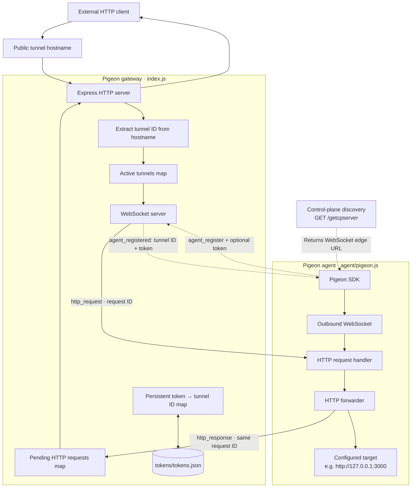
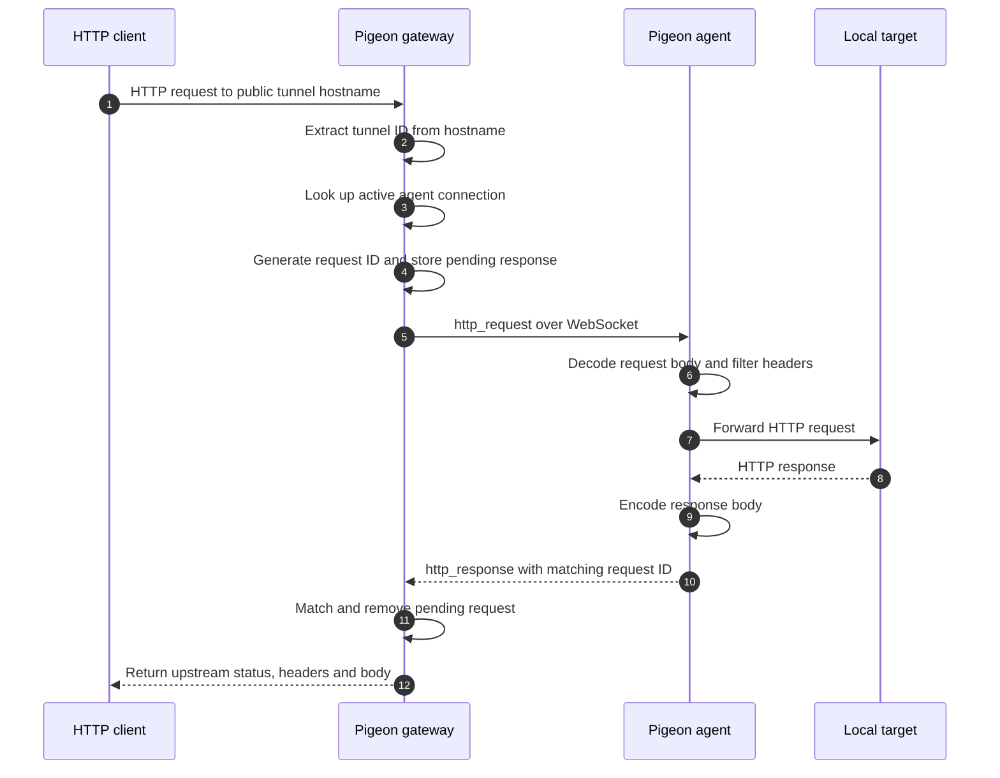
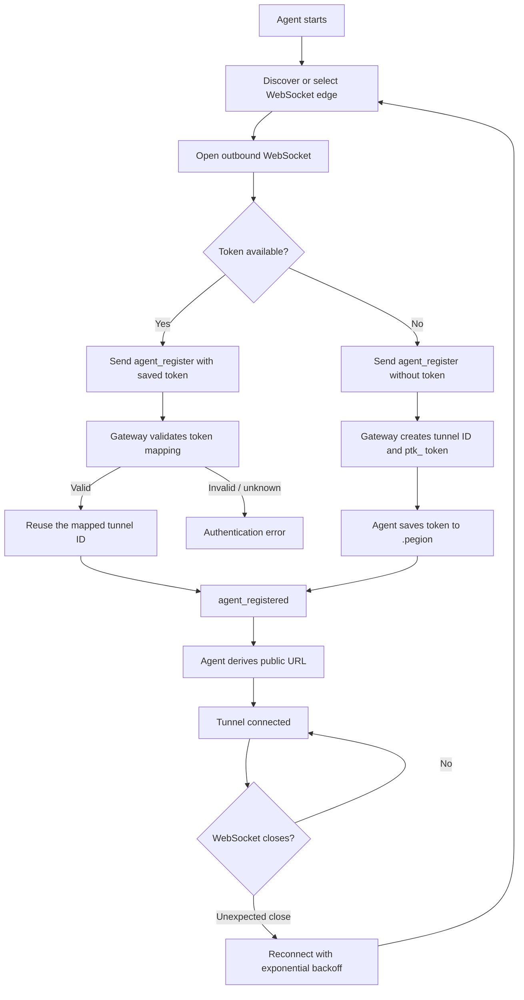

# Pigeon

**Expose local HTTP services through a WebSocket reverse tunnel.**

Pigeon lets an application running on a private machine or container receive HTTP traffic through a public hostname, without requiring the application itself to accept inbound internet connections.

The repository contains the gateway and the Node.js agent. The agent opens an outbound WebSocket connection to the gateway, authenticates with a persistent token, and forwards requests between the gateway and a configured HTTP target.

## How it works

Pigeon has three moving parts:

- **Control-plane discovery** tells an agent which WebSocket edge to connect to.
- **Gateway** accepts agent WebSocket connections and public HTTP requests, authenticates agents, and routes requests to the right active connection.
- **Agent** maintains the outbound WebSocket connection and proxies incoming requests to the local HTTP target.

### System architecture



The control-plane endpoint and the gateway have separate responsibilities: discovery supplies the edge URL; the gateway handles agent authentication and HTTP traffic.

### HTTP request lifecycle



Requests are correlated with generated IDs, allowing multiple HTTP requests to be in flight over the same agent connection. The gateway applies a 30-second pending-request timeout; the agent also has a configurable upstream request timeout.

### Agent registration and persistent identity



On first registration, the gateway generates a tunnel ID and a token in the `ptk_` format. By default, the agent stores the token in a local `.pegion` file. On a later connection, it presents that token and the gateway restores the associated tunnel ID.

The gateway persists token-to-tunnel mappings in `tokens/tokens.json`. The active WebSocket connection itself is in memory and must reconnect before the tunnel can serve traffic again. **A persistent identity preserves the assigned tunnel hostname; it does not make a disconnected agent available.**

## Repository layout

```text
.
├── index.js                 # Express gateway and WebSocket server
├── agent/
│   ├── pigeon.js            # Node.js agent SDK
│   └── README.md             # Agent usage and configuration
├── utils/
│   ├── tokens.js             # Token generation and validation
│   └── filterHeaders.js      # Gateway-side hop-by-hop header filtering
├── tokens/
│   └── tokens.json           # Created at runtime; token-to-tunnel mappings
└── .env.example
```

## Getting started

### Run the gateway

Requirements: Node.js and npm.

```bash
npm install
npm run dev
```

The gateway listens on `PORT`, defaulting to `8000`. Set `WSPRODURI` to the WebSocket edge URL returned by the discovery endpoint. In the current implementation, `GET /getcpserver` returns that configured URL.

The public gateway also needs to be reachable through the domain used for tunnel hostnames. The first hostname label is used as the tunnel ID, so wildcard DNS and appropriate proxy/routing configuration are required.

### Run an agent

The agent is in `agent/pigeon.js` and depends on the `ws` package. In an application that has an HTTP server listening on port `3000`:

```bash
npm install ws
```

```js
const Pigeon = require("./agent/pigeon");

async function main() {
    const tunnel = await Pigeon({
        target: "http://127.0.0.1:3000"
    });

    const connection = await tunnel.connect();

    console.log("Public URL:", connection.url);
    console.log("Tunnel ID:", connection.tunnelId);
}

main().catch(console.error);
```

The target application must already be listening when requests arrive. See [agent/README.md](agent/README.md) for the full configuration reference, connection lifecycle, logging, and troubleshooting details.

## Configuration

The agent accepts an options object. Common options include:

| Option | Purpose |
| --- | --- |
| `target` | HTTP URL to forward requests to |
| `port` | Convenience option for `http://127.0.0.1:<port>` when `target` is omitted |
| `domain` | Domain used to construct the public tunnel URL |
| `wsURL` / `edgeURL` | Explicit WebSocket edge, bypassing discovery |
| `controlPlaneURL` | Control-plane discovery endpoint |
| `fallbackURL` | WebSocket URL used if discovery fails |
| `devMode` / `dev` | Connect to the local development gateway |
| `tokenFile` | Path used to read and save the token; defaults to `.pegion` |
| `tokenOverride` / `token` / `authToken` | Explicit token instead of the token file |
| `requestTimeout` | Timeout for forwarding a request to the local target |
| `discoveryTimeout` | Timeout for control-plane discovery |

For all supported options and defaults, consult [agent/README.md](agent/README.md).

## Request forwarding details

- The gateway accepts HTTP requests and sends an `http_request` message over the agent's WebSocket.
- Request bodies are transported as Base64-encoded data.
- The agent forwards the request to the configured target using `fetch`.
- The agent sends an `http_response` message containing the original request ID, status, headers, and Base64-encoded response body.
- The gateway matches that ID to the waiting HTTP response.
- Hop-by-hop headers are filtered during forwarding.

The current gateway configures a 10 MB body limit. The request and response transport buffers bodies in memory; this is not a streaming file-transfer protocol.

## Reconnection

The agent retries unexpected connection failures with exponential backoff, starting at one second and capping at 30 seconds. Calling `disconnect()` cancels reconnection and closes the active socket.

> [!WARNING]
> Public tunnels expose their configured target. Only expose services intended to be public.
>
> - Keep `ptk_` tokens and `.pegion` / `tokens/tokens.json` private.
> - Protect sensitive routes in the target application.
> - Use `wss://` in production.
> - Pigeon handles transport, not application authorization.

## Project status

Pigeon is under active development. Configuration, protocol details, and deployment requirements may change.

## License

See [LICENSE](LICENSE).
