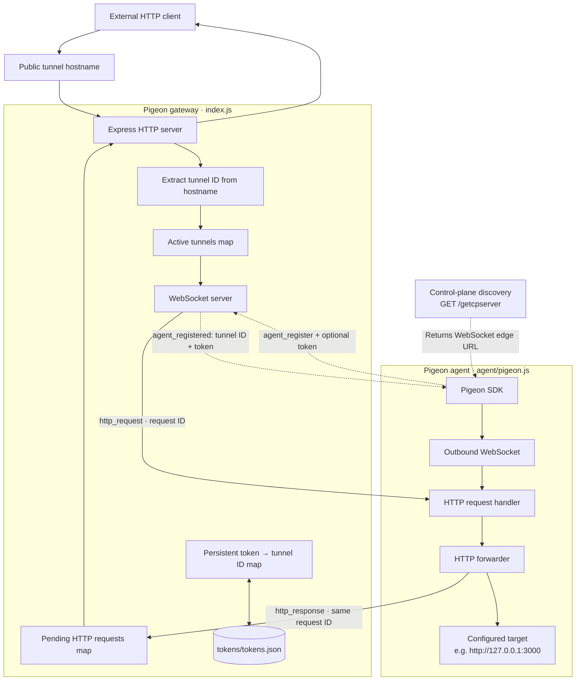
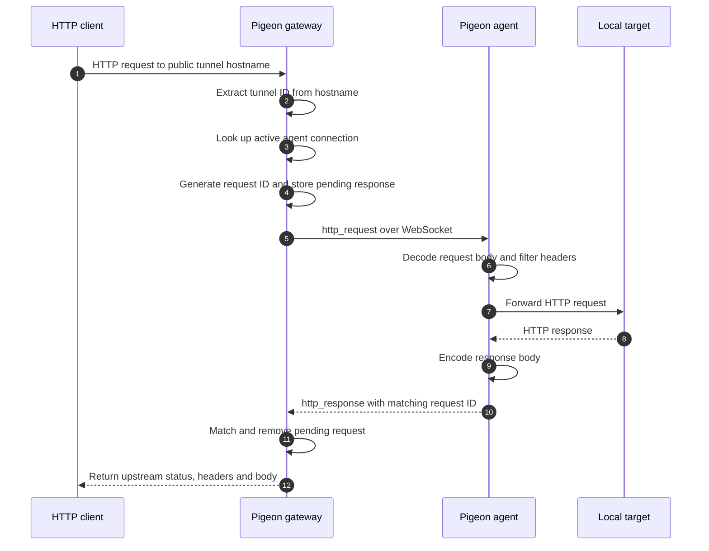
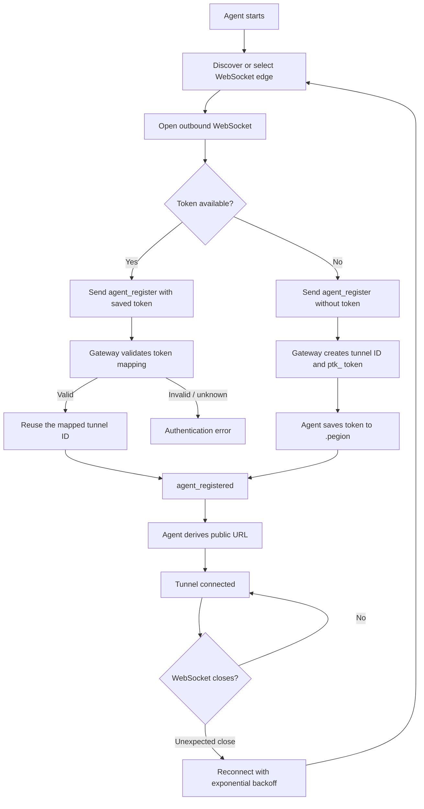

# Pigeon

> [!WARNING]
> Security warning
>
> - Keep `ptk_` tokens and `.pegion` and add them to the gitignore
> - Pigeon handles transport, not application authorization.

**Expose local HTTP services through a WebSocket reverse tunnel.**

Pigeon lets an application running on a private machine or container receive HTTP traffic through a public hostname, without requiring the application itself to accept inbound internet connections.

## Getting started

Use the [Tunneling Agent Guide](https://github.com/SaaranshDx/Pigeons/blob/main/agent/README.md)

## How it works

Pigeon has three moving parts:

- **Control-plane discovery** tells an agent which WebSocket edge to connect to.
- **Gateway** accepts agent WebSocket connections and public HTTP requests, authenticates agents, and routes requests to the right active connection.
- **Agent** maintains the outbound WebSocket connection and proxies incoming requests to the local HTTP target.

### architecture

The control-plane endpoint and the gateway have separate responsibilities: discovery supplies the edge URL; the gateway handles agent authentication and HTTP traffic.

### HTTP request lifecycle

Requests are correlated with generated IDs, allowing multiple HTTP requests to be in flight over the same agent connection. The gateway applies a 30-second pending-request timeout; the agent also has a configurable upstream request timeout.

### Agent registration and persistent identity

On first registration, the gateway generates a tunnel ID and a token in the `ptk_` format. By default, the agent stores the token in a local `.pegion` file. On a later connection, it presents that token and the gateway restores the associated tunnel ID.

The gateway persists token-to-tunnel mappings in `tokens/tokens.json`. The active WebSocket connection itself is in memory and must reconnect before the tunnel can serve traffic again. **A persistent identity preserves the assigned tunnel hostname; it does not make a disconnected agent available.**
